<h1>Alberto Peinado Santana</h1>

  

## Directory

Every project, where to use it today, and where to try the apps before they reach the stores.

<table>
  <thead>
    <tr><th width="72"></th><th align="left">Project</th><th width="190" align="left">Try it</th></tr>
  </thead>
  <tbody>
    <tr>
      <td align="center"></td>
      <td><strong>Cloudpylon</strong> Compare cloud server, managed database and AI sandbox pricing across providers.</td>
      <td><a href="https://cloudpylon.com">cloudpylon.com&nbsp;↗</a></td>
    </tr>
    <tr>
      <td align="center"></td>
      <td><strong>CS2Sticker</strong> Browse Counter-Strike 2 stickers and preview sticker crafts on a weapon in 3D.</td>
      <td><a href="https://cs2sticker.com">cs2sticker.com&nbsp;↗</a></td>
    </tr>
    <tr>
      <td align="center"></td>
      <td><strong>Parfumalia</strong> A fragrance catalog: notes, accords, perfumers and how people rate each one.</td>
      <td><a href="https://parfumalia.com">parfumalia.com&nbsp;↗</a></td>
    </tr>
    <tr>
      <td align="center"></td>
      <td><strong>Rumis</strong> A shared home on the same page: rotating chores, one shopping list, expenses and a calendar.</td>
      <td><a href="https://rumisapp.com">rumisapp.com&nbsp;↗</a>  </td>
    </tr>
    <tr>
      <td align="center"></td>
      <td><strong>Outfity</strong> Your wardrobe on your iPhone: save outfits, sort them and plan each day. No account.</td>
      <td><a href="https://outfityapp.com">outfityapp.com&nbsp;↗</a>  </td>
    </tr>
    <tr>
      <td align="center"></td>
      <td><strong>Trenes Ahora</strong> Live departures from any station in Spain, with delays, cancellations and platforms.</td>
      <td><a href="https://trenesahora.com">trenesahora.com&nbsp;↗</a>  </td>
    </tr>
    <tr>
      <td align="center"></td>
      <td><strong>Transportes Granada</strong> Granada's urban buses and metro, live, plus the interurban bus timetable.</td>
      <td><a href="https://transportegranada.com">transportegranada.com&nbsp;↗</a>  </td>
    </tr>
    <tr>
      <td align="center"></td>
      <td><strong>Peckly</strong> Personal reminders and lists, local-first, with optional account sync.</td>
      <td></td>
    </tr>
  </tbody>
</table>

TestFlight is Apple's beta app: open a link on your iPhone, install TestFlight, then the app. App Store and Google Play links will replace these once the apps are listed.

<!--
When a store listing goes live, put its official badge in the "Try it" cell, next to the TestFlight one or in its place:
  App Store:   https://apps.apple.com/app/id<app-id>  with Apple's "Download on the App Store" badge (only once the app is live).
  Google Play: https://play.google.com/store/apps/details?id=<package>  with Google's "Get it on Google Play" badge.
-->
