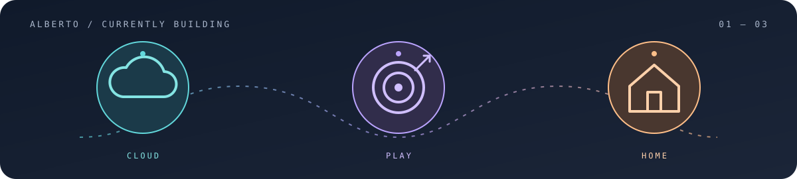

<h1>Alberto Peinado Santana</h1>

Lead Architect at <strong>NTT DATA Europe &amp; Latam</strong> · Spain

<em>Turning complex problems and messy data into simple, beautifully crafted products people actually use.</em>

<a href="https://www.linkedin.com/in/albertopeinadosantana/">LinkedIn</a>

## On the workbench

Three live products. Three very different problems. The same curiosity behind each one.

---

01 / CLOUD INTELLIGENCE

### 🖥️ [Cloudpylon](https://cloudpylon.com)

**Find the right cloud machine without getting lost in the options.**

A multi-cloud compute instance benchmark and real-time pricing intelligence platform. Compare compute instances, hardware specifications (vCPU, RAM, GPU, storage), machine images, and regional pricing across 13+ cloud providers—including AWS, Azure, Google Cloud, Hetzner, Scaleway, and DigitalOcean—with live currency conversion.

**[Explore Cloudpylon →](https://cloudpylon.com)**

---

02 / GAMING ASSETS & 3D STUDIO

### 🎮 [CS2Sticker](https://cs2sticker.com)

**Go from finding a sticker to imagining the finished craft.**

A Counter-Strike 2 catalog and interactive 3D craft studio. Explore stickers, skins, tournament capsules, and market data, then inspect, position, rotate, and simulate wear on custom sticker crafts with a real-time 3D weapon visualizer before trading or crafting in-game.

**[Explore CS2Sticker →](https://cs2sticker.com)**

---

03 / HOUSEHOLD PLATFORM

### 🧑‍🤝‍🧑 [Rumis](https://rumisapp.com)

**Make sharing a home feel a little lighter.**

Shared household management for roommates and couples. Rumis brings calm and structure to shared living with fair expense splitting, automated debt settlements, recurring chore schedules, communal grocery lists, and shared home activity in one intuitive mobile experience.

**[Explore Rumis →](https://rumisapp.com)**

---

From cloud servers to sticker crafts to the place we call home: build it, ship it, keep making it better.

